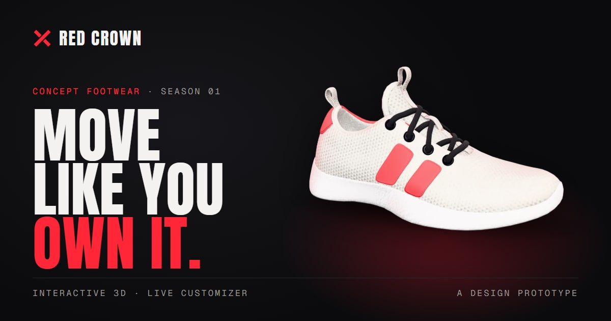
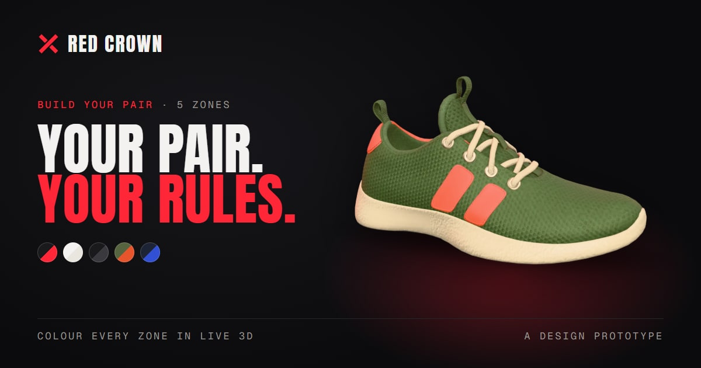

<div align="center">



# Red Crown — Concept Footwear Storefront

**A multi-page, fully responsive design prototype for a fictional sneaker label — built around an interactive 3D shoe and a live colour customizer.**


[Features](#-features) · [Pages](#-pages) · [Tech stack](#-tech-stack) · [Run locally](#-getting-started) · [Deploy](#-deployment) · [Credits](#-credits)

</div>

---

## 👟 About the project

**Red Crown** is an imaginary footwear brand, and this repository is its concept storefront — a portfolio piece exploring how a premium, campaign-style product site can feel: deep black surfaces, bold condensed type, and controlled neon-red light around a real-time 3D sneaker.

It behaves like a real shop — browse, filter, pick a size, build your own colourway, fill a bag — but it's a **design prototype**:

> [!NOTE]
> Red Crown is not a real company. Products and prices are concept-only, the bag lives in your browser's local storage, and **no purchase or payment is ever processed**.

<div align="center">

</div>

## ✨ Features

- **Interactive 3D hero shoe** — drag or use the keyboard to rotate it, with sensible limits, a reset control, and touch support that never hijacks page scrolling.
- **Live shoe customizer** — recolour five zones (upper, tape & heel, laces, midsole, outsole) from a curated palette or a custom colour picker, start from presets, see a design summary, and have your draft saved locally.
- **Working collection** — eight original shoe designs with category and tone filters plus sorting, all kept in the URL so views are shareable.
- **Product detail pages** — 3D view, colourway, size and quantity selection with validation and clear feedback; unknown products get a proper 404.
- **Demo shopping bag** — add, remove, change quantities and watch the subtotal update, with an honest "this is a demo" checkout dialog.
- **Graceful fallbacks** — every view has a pre-rendered still for loading, low-power devices and browsers without WebGL. Add `?webgl=off` to any URL to try it.
- **Performance-minded 3D** — lazy-loaded canvas, capped pixel ratio, minimal lighting, and rendering that pauses when the shoe is offscreen or the tab is hidden.
- **Accessible & motion-aware** — semantic landmarks, labelled controls, visible focus states, keyboard support throughout, and a calm static presentation under `prefers-reduced-motion`.
- **SEO & share-ready** — per-page metadata and canonical URLs, Open Graph / Twitter cards, sitemap, robots, web manifest and structured data.

## 🗺️ Pages

| Route | What you'll find |
| --- | --- |
| `/` | Campaign hero with the interactive 3D shoe, the line-up, a "built in layers" scroll story and a customizer teaser |
| `/shop` | The full collection with category/tone filters, sorting, an empty state and quick add-to-bag |
| `/product/[slug]` | Shared product template: 3D view, colourway, size, quantity and validated add to bag |
| `/customize` | Five-zone configurator with presets, palette + custom colour, live 3D, summary, reset and local draft |
| `/story` | The design principles and imagined process behind the collection |
| `/bag` | Demo bag with quantities, remove, subtotal and a clearly labelled demo checkout |
| `/privacy` | What the demo stores (only local storage) and what it doesn't |

**The collection:** Strand · Kerb · Filament · Overpass · Drift · Margin · Cadence · Transit — across *Run*, *Street* and *Studio* categories.

## 🛠️ Tech stack

| Area | Tools |
| --- | --- |
| Framework | **Next.js 16** (App Router, static export, Turbopack) · **React 19** · **TypeScript** |
| Styling | **Tailwind CSS v4**, with brand design tokens defined in `app/globals.css` (`@theme`) |
| 3D | **three.js** + **React Three Fiber** — the shoe is lazy-loaded on the client and recoloured live per zone by a small custom shader |
| Motion | **Motion** for layout/presence animation, CSS for simple states, native **View Transitions** between routes |
| Icons & fonts | **Lucide** icons · Anton, Geist and Geist Mono self-hosted via `next/font` |

No backend, database or API keys — the whole site builds to plain static files.

## 🚀 Getting started

### Prerequisites

- [Node.js](https://nodejs.org/) **20.9 or newer** (22 LTS recommended)
- npm (comes with Node)

### Run it locally

```bash
# 1. Clone the repository
git clone https://github.com/RonakChavda-Dev/red-tape-shoes-prototype.git
cd red-tape-shoes-prototype

# 2. Install dependencies
npm install

# 3. Start the dev server
npm run dev
```

Then open **http://localhost:3000** in your browser.

### Production build

```bash
npm run build   # creates a fully static site in out/
npm start       # serves out/ locally
```

### Available scripts

| Command | Description |
| --- | --- |
| `npm run dev` | Start the development server with hot reload |
| `npm run build` | Build the static production site into `out/` |
| `npm start` | Serve the built `out/` folder locally |
| `npm run lint` | Run ESLint |
| `npm run typecheck` | Run the TypeScript compiler without emitting files |

## 📁 Project structure

```text
app/                    Routes (home, shop, product/[slug], customize, story, bag, privacy),
                        layout, global styles, metadata, sitemap and robots
components/             UI components — header, footer, product cards, customizer, bag…
  shoe/                 The 3D shoe: asset loading, zone shader, canvas and stage/fallback
data/products.ts        Single source for products, colourways, zones, palette and presets
lib/                    Bag and draft stores (localStorage), SEO helpers, formatting, colour utils
public/
  models/               The optimised shoe.glb and its texture maps
  images/shoes/         Still renders used for cards, posters and the no-WebGL fallback
  og/                   1200×630 social share images
scripts/
  og/                   Script that renders the share images
  shoe-pipeline/        How the 3D model and renders were produced
```

A few places worth knowing:

- **Add or edit a shoe** in `data/products.ts` — cards, product pages, the sitemap and filters all read from it.
- **Change brand colours, type or spacing** in the `@theme` tokens in `app/globals.css`.
- **The 3D pipeline** lives in `components/shoe/` — `shoe-assets.ts` loads the model and tints each zone while keeping the scanned shading; `shoe-stage.tsx` handles the poster, lazy loading, rotation controls and offscreen pausing.

## 🌐 Deployment

The site is a static export (`output: "export"`) — plain HTML, JS, images and the 3D model, with no server — so it can be hosted on any static host.

**Cloudflare Pages**

| Setting | Value |
| --- | --- |
| Build command | `npm run build` |
| Build output directory | `out` |
| Environment variable | `NODE_VERSION` = `22` |

> [!NOTE]
> Canonical URLs, the sitemap and share images use `https://redcrown-prototype.pages.dev` by default (see `PRODUCTION_URL` in `lib/seo.ts`). To deploy on another domain, change that constant or set `NEXT_PUBLIC_SITE_URL` at build time.

**Updating share images:** after changing products or renders, regenerate the images in `public/og/` with `scripts/og/render-og.mjs`, then bump `OG_VERSION` in `lib/seo.ts` so social platforms fetch the new ones.

## 🙏 Credits

- The 3D shoe is based on [“Materials Variants Shoe”](https://github.com/KhronosGroup/glTF-Sample-Assets/tree/main/Models/MaterialsVariantsShoe) © 2021 Shopify, licensed [CC BY 4.0](https://creativecommons.org/licenses/by/4.0/). Modified: original colourways removed, demo marks painted out, and recoloured by zone.
- The Red Crown name, X mark, colourways, copy and branding are original to this concept.

## ⚠️ Disclaimer

This is a portfolio / design prototype. Red Crown is a fictional brand; there are no real products, stock, prices, customers or payments. Nothing on the site collects personal data — the bag and customizer draft are stored only in your own browser.

<div align="center">

Designed and built by **Ronak Chavda**

</div>
